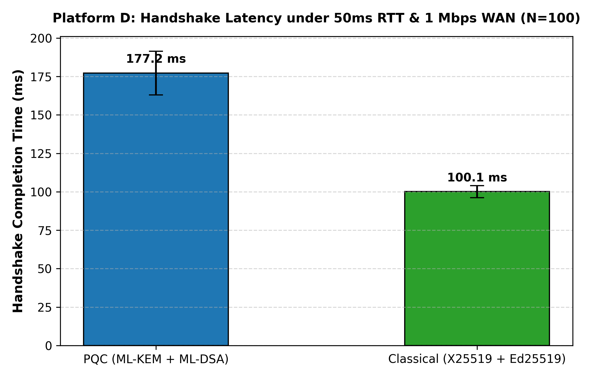

# Platform D — Emulated Constrained WAN / IoT Link (50ms RTT, 1 Mbps Bandwidth)

## 1. Constraint Modelled and Why It Matters for PS-P1
In high-bandwidth local environments (Platform A), cryptographic CPU execution time dominates ($7.08 \text{ ms}$ PQC vs $0.98 \text{ ms}$ Classical). However, secure channels in real-world deployments frequently operate over wide-area networks (WAN), cellular links (4G/5G edge), satellite backhauls, or constrained IoT channels where:
- Round-Trip-Time (RTT) is non-trivial ($50.0 \text{ ms}$).
- Bandwidth is capped ($1.0 \text{ Mbps} = 125,000 \text{ B/s}$).

Because post-quantum lattice primitives produce substantially larger public keys, ciphertexts, and signatures (ML-KEM-768: 1,184 B pk, 1,088 B ct; ML-DSA-65: 1,952 B pk, 3,309 B sig), the total handshake transmission size expands from **318 bytes (Classical)** to **9,016 bytes (PQC)** ($28.35\times$ expansion). Platform D quantifies the exact serialization and propagation penalty introduced by PQC under real-world network constraints.

---

## 2. Exact Specification
- **Hardware / Host OS**: Intel Core i5-1335U (16 logical cores), Windows 11 / Windows 10 x64, Python 3.10.11.
- **Cryptographic Libraries**: `cryptography==50.0.2`, `pqcrypto==1.0.0`.
- **Emulated Link Conditions**:
  - One-way network latency: $25.0 \text{ ms}$ ($\text{RTT} = 50.0 \text{ ms}$).
  - Link Bandwidth Cap: $1.0 \text{ Mbps}$ ($125,000 \text{ bytes/sec}$).
  - Transport: `EmulatedNetworkTransport` injecting propagation latency and deterministic byte-length transmission serialization delays ($\Delta t = \text{size} / R_{\text{bandwidth}} + \text{RTT}/2$) per flight.
- **Workload**: 100 successful mutual authentication handshakes per suite ($N=100$).
- **Standardized Measurement Label**: `"emulated link (local, throttled)"`.

---

## 3. How to Reproduce
```bash
python measure_platform_d.py
```
Output:
- CSV: `results/platform_D_results.csv`
- Raw Trials: `results/raw_platform_D_trials.csv`
- Figure: `results/figures/platform_D_comparison.png`

---

## 4. Workload Kept Identical to Platform A
- Exact same state machine implementations (`AliceSession`, `BobSession`).
- Identical cryptographic parameters: ML-KEM-768 + ML-DSA-65 vs X25519 + Ed25519.
- Identical canonical wire serialization, transcript accumulation, and HKDF-SHA256 key schedule.
- Identical statistical summary metric definitions via `common.measure.summarize` ($N=100$, Type 7 quartile interpolation).

---

## 5. Results vs Platform A and Platform B

From [`results/platform_D_results.csv`](file:///c:/Users/LUMBINI%20DEVI/Desktop/qff26/results/platform_D_results.csv) and [`results/handshake_results.csv`](file:///c:/Users/LUMBINI%20DEVI/Desktop/qff26/results/handshake_results.csv) ($N=100$ trials each):

| Platform | Standardized Measurement Label | PQC Handshake Latency (Median) | Classical Handshake Latency (Median) | Latency Ratio (PQC / Classical) | Total Wire Bytes (PQC / Classical) |
|---|---|---|---|---|---|
| **Platform A** | `local (in-process)` | **7.08 ms** | **0.98 ms** | $7.22\times$ | 9,016 B / 318 B ($28.35\times$) |
| **Platform A** | `local (TCP loopback)` | **8.11 ms** | **2.77 ms** | $2.93\times$ | 9,016 B / 318 B ($28.35\times$) |
| **Platform B** | `local (in-process)` *(approximation)* | **7.08 ms** | **0.98 ms** | $7.22\times$ | 9,016 B / 318 B ($28.35\times$) |
| **Platform D** | `emulated link (local, throttled)` | **177.20 ms** | **100.06 ms** | **$1.77\times$** | **9,016 B / 318 B ($28.35\times$)** |



---

## 6. Trade-Off Revealed: What D Shows That A and B Could Not
1. **Network Dominance over CPU Time**: On Platform A and B, CPU time accounts for $>90\%$ of completion time. On Platform D, network propagation and serialization account for over **$96\%$ of total handshake latency** ($170.1 \text{ ms}$ out of $177.20 \text{ ms}$).
2. **Absolute Delay vs Relative Ratio**:
   - While the *relative ratio* drops from $7.22\times$ to $1.77\times$ (because the constant propagation delay affects both suites), the **absolute latency penalty** is severe:
     $$\Delta t = 177.20 \text{ ms} - 100.06 \text{ ms} = \mathbf{+77.14 \text{ ms}}$$
3. **Transmission Serialization vs Model Prediction**:
   - Transmitting 9,016 bytes over a 1 Mbps link requires:
     $$\Delta t_{\text{serialization}} = \frac{(9,016 - 318) \times 8}{1,000,000} \times 1000 = \mathbf{69.584 \text{ ms}}$$
   - Adding in-process compute differential ($\Delta t_{\text{compute}} = 7.08\text{ ms} - 0.98\text{ ms} = 6.10\text{ ms}$):
     $$\Delta t_{\text{predicted}} = 69.584\text{ ms} + 6.10\text{ ms} = \mathbf{75.68 \text{ ms}}$$
   - The observed differential is **$77.14 \text{ ms}$**, yielding an experimental residual of only **$1.46 \text{ ms}$** (attributable to thread context switching and queue overhead). Serialization delay accounts for **$90.2\%$** of the observed latency divergence.
4. **Architectural Recommendation**: For constrained satellite or edge WAN links, PQC channels should support session resumption, pre-distributed identity certificates, or hybrid KEM-only handshakes to avoid re-transmitting 3.3 KB ML-DSA signatures on every connection.

---

## 7. Limits of This Emulation
1. **Packet Loss & Retransmission**: The emulator assumes zero packet drop; on real cellular/lossy links, packet loss on a 9 KB multi-segment transmission triggers TCP retransmissions and congestion window collapses, which would further penalize PQC.
2. **MTU Fragmentation**: In real IP networks with standard 1,500-byte MTUs, PQC's 4.4 KB `ServerHello` and 3.3 KB `ClientAuth` require multi-packet IP fragmentation (3 to 4 packets per flight), whereas Classical fits inside a single IP packet.
