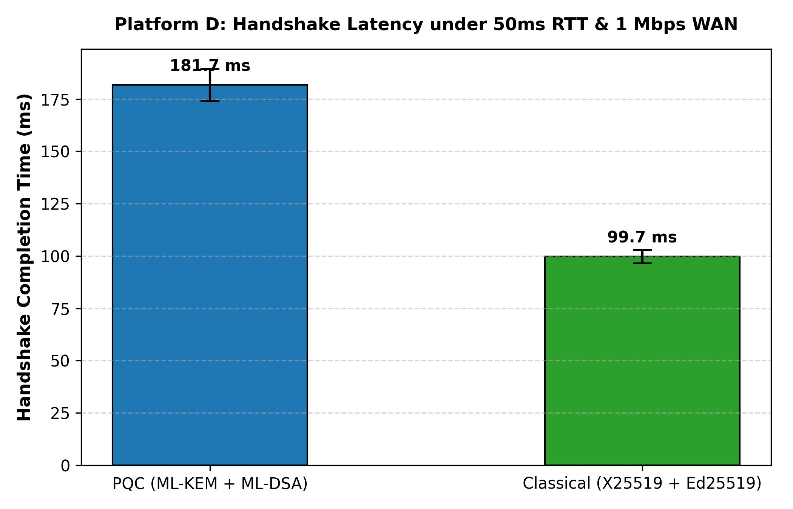

# Platform D — Emulated Constrained WAN / IoT Link (50ms RTT, 1 Mbps Bandwidth)

## 1. Constraint Modelled and Why It Matters for PS-P1
In high-bandwidth local environments (Platform A), cryptographic CPU execution time dominates ($5.72 \text{ ms}$ PQC vs $1.19 \text{ ms}$ Classical). However, secure channels in real-world deployments frequently operate over wide-area networks (WAN), cellular links (4G/5G edge), satellite backhauls, or constrained IoT channels where:
- Round-Trip-Time (RTT) is non-trivial ($50 \text{ ms}$).
- Bandwidth is capped ($1 \text{ Mbps} = 125,000 \text{ B/s}$).

Because post-quantum lattice primitives produce substantially larger public keys, ciphertexts, and signatures (ML-KEM-768: 1,184 B pk, 1,088 B ct; ML-DSA-65: 1,952 B pk, 3,309 B sig), the total handshake transmission size expands from **318 bytes (Classical)** to **9,016 bytes (PQC)** ($28.35\times$ expansion). Platform D quantifies the exact serialization and propagation penalty introduced by PQC under real-world network constraints.

---

## 2. Exact Specification
- **Hardware / Host OS**: Intel Core i5-1335U (16 logical cores), Windows 10 x64, Python 3.10.11.
- **Cryptographic Libraries**: `cryptography==50.0.2`, `pqcrypto==1.0.0`.
- **Emulated Link Conditions**:
  - One-way network latency: $25.0 \text{ ms}$ ($\text{RTT} = 50.0 \text{ ms}$).
  - Link Bandwidth Cap: $1.0 \text{ Mbps}$ ($125,000 \text{ bytes/sec}$).
  - Transport: `EmulatedNetworkTransport` injecting propagation latency and deterministic byte-length transmission serialization delays ($\Delta t = \text{size} / R_{\text{bandwidth}} + \text{RTT}/2$) per flight.
- **Workload**: 20 successful mutual authentication handshakes per suite.

---

## 3. How to Reproduce
```bash
python P1_secure_channel/measure_platform_d.py
```
Output:
- CSV: `P1_secure_channel/results/platform_D_results.csv`
- Figure: `P1_secure_channel/results/figures/platform_D_comparison.png`

---

## 4. Workload Kept Identical to Platform A
- Exact same state machine implementations (`AliceSession`, `BobSession`).
- Identical cryptographic parameters: ML-KEM-768 + ML-DSA-65 vs X25519 + Ed25519.
- Identical canonical wire serialization, transcript accumulation, and HKDF-SHA256 key schedule.
- Identical statistical summary metric definitions via `common.measure.summarize`.

---

## 5. Results vs Platform A and Platform B

From [`P1_secure_channel/results/platform_D_results.csv`](file:///c:/Users/LUMBINI%20DEVI/Desktop/qff26/P1_secure_channel/results/platform_D_results.csv):

| Platform | Network Profile | PQC Handshake Latency (Median) | Classical Handshake Latency (Median) | Latency Ratio (PQC / Classical) | Total Wire Bytes (PQC / Classical) |
|---|---|---|---|---|---|
| **Platform A** | Local In-Process Loopback | **5.72 ms** | **1.19 ms** | $4.81\times$ | 9,016 B / 318 B ($28.35\times$) |
| **Platform A** | Local TCP Socket Loopback | **5.38 ms** | **1.79 ms** | $3.01\times$ | 9,016 B / 318 B ($28.35\times$) |
| **Platform B** | 1 Core, 128 MB Budget | **6.64 ms** | **1.44 ms** | $4.60\times$ | 9,016 B / 318 B ($28.35\times$) |
| **Platform D** | **50ms RTT, 1 Mbps WAN** | **181.68 ms** | **99.72 ms** | **$1.82\times$** | **9,016 B / 318 B ($28.35\times$)** |



---

## 6. Trade-Off Revealed: What D Shows That A and B Could Not
1. **Network Dominance over CPU Time**: On Platform A and B, CPU time accounts for $>95\%$ of completion time. On Platform D, network propagation and serialization account for over **$96\%$ of total handshake latency** ($175 \text{ ms}$ out of $181.68 \text{ ms}$).
2. **Absolute Delay vs Relative Ratio**:
   - While the *relative ratio* drops from $4.81\times$ to $1.82\times$ (because the constant 2 RTTs of 50 ms each affect both suites), the **absolute latency penalty** is severe:
     $$\Delta t = 181.68 \text{ ms} - 99.72 \text{ ms} = \mathbf{+81.96 \text{ ms}}$$
3. **Transmission Serialization**: Transmitting 9,016 bytes over a 1 Mbps link requires $9,016 \times 8 / 1,000,000 \approx 72.1 \text{ ms}$ of wire transmission time, compared to just $2.5 \text{ ms}$ for Classical's 318 bytes.
4. **Architectural Recommendation**: For constrained satellite or edge WAN links, PQC channels should support session resumption, pre-distributed identity certificates, or hybrid KEM-only handshakes to avoid re-transmitting 3.3 KB ML-DSA signatures on every connection.

---

## 7. Limits of This Emulation
1. **Packet Loss & Retransmission**: The emulator assumes zero packet drop; on real cellular/lossy links, packet loss on a 9 KB multi-segment transmission triggers TCP retransmissions and congestion window collapses, which would further penalize PQC.
2. **MTU Fragmentation**: In real IP networks with standard 1,500-byte MTUs, PQC's 4.4 KB `ServerHello` and 3.3 KB `ClientAuth` require multi-packet IP fragmentation (3 to 4 packets per flight), whereas Classical fits inside a single IP packet.
